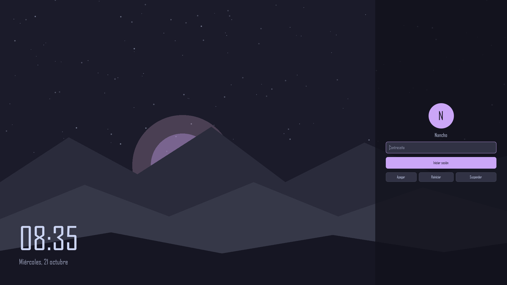

# Nocturne Login (tema para SDDM)

Pantalla de inicio de sesion oscura para **SDDM con Qt 6**: reloj grande a un lado y panel lateral
translucido (sin desenfoque) con usuario, contrasena, sesion y botones de apagado.
Usa la paleta Catppuccin Mocha. Es un diseno independiente, escrito desde cero (no deriva de otros temas)
y no es un proyecto oficial de Catppuccin.



*Captura generada cargando el propio QML con datos de prueba (`tools/render_preview.py`). La tipografia
depende de tu sistema; en la captura es una fuente de Windows.*

## Importante: solo para SDDM

Este tema **no funciona con Plasma Login Manager**, el gestor nuevo que usan algunas versiones recientes
de Fedora KDE, porque ese gestor no admite temas QML propios. Comprueba cual tienes:

```bash
systemctl status display-manager --no-pager | head -n 5
```

Si ves `plasmalogin.service`, necesitas cambiar a SDDM antes de poder usar este tema.

## Instalacion

```bash
git clone https://github.com/nanchoip/nocturne-login-sddm.git
cd nocturne-login-sddm
./install.sh
```

El script solo copia el tema a `/usr/share/sddm/themes/nocturne-login`. No cambia el gestor de inicio de sesion.

### Probarlo sin cerrar sesion

Hace falta tener SDDM instalado (`sudo dnf install sddm qt6-qtsvg qt6-qtmultimedia`), aunque no este activado:

```bash
sddm-greeter-qt6 --test-mode --theme /usr/share/sddm/themes/nocturne-login
```

Si algo falla, los errores de QML salen en esa terminal.

### Activarlo (si SDDM es tu gestor)

`/etc/sddm.conf` tiene prioridad sobre los ajustes de `/etc/sddm.conf.d/`:

```bash
printf '[Theme]\nCurrent=nocturne-login\n' | sudo tee /etc/sddm.conf
```

Rescate si algo sale mal: `Ctrl + Alt + F3`, inicia sesion y ejecuta
`sudo rm /etc/sddm.conf && sudo reboot`.

## Configuracion

No edites `theme.conf` directamente (se pisa al reinstalar): crea
`/usr/share/sddm/themes/nocturne-login/theme.conf.user` con solo lo que quieras cambiar. Ejemplo:

```ini
[General]
background=/usr/share/backgrounds/mi-fondo.jpg
panelSide=left
accentColor=#89b4fa
dimBackground=0.4
```

| Opcion | Por defecto | Descripcion |
|---|---|---|
| `background` | `backgrounds/default.png` | Imagen de fondo (ruta relativa al tema o absoluta). Si no existe, se usa `baseColor`. |
| `dimBackground` | `0.2` | Oscurece el fondo, de 0 a 1. |
| `panelSide` | `right` | Lado del panel: `right` o `left`. El reloj va al contrario. |
| `panelWidthPercent` | `26` | Ancho del panel en % de pantalla (18 a 60). |
| `showClock` | `true` | Mostrar reloj y fecha. |
| `clockFormat` | `HH:mm` | Formato de hora de Qt (por ejemplo `hh:mm AP`). |
| `dateFormat` | `dddd, d MMMM` | Formato de fecha de Qt. |
| `locale` | *(vacio)* | Idioma de la fecha. Vacio usa el del sistema; si el login sale en ingles, pon `es_ES`. |
| `showUserSelector` | `auto` | `auto` (solo si hay varios usuarios), `true` o `false`. |
| `showSessionSelector` | `auto` | Selector de sesion (Plasma Wayland/X11...): `auto` (solo si hay varias sesiones; discreto al final del panel), `true` o `false`. |
| `showPowerButtons` | `true` | Botones de apagar, reiniciar y suspender. |
| `showHibernate` | `false` | Anade el boton de hibernar si el sistema lo permite. |
| `baseColor` `panelColor` `fieldColor` `borderColor` | Catppuccin Mocha | Colores. `panelColor` usa `#AARRGGBB` (los dos primeros digitos son la opacidad). |
| `accentColor` `accentTextColor` | `#cba6f7` `#11111b` | Color de acento y color del texto sobre el acento. |
| `textColor` `mutedColor` `dangerColor` | ver `theme.conf` | Texto, texto secundario y errores. |

Todo se escala segun la altura de pantalla (referencia: 1080 px), asi que funciona en 768p, 1440p o 4K.

## Estado

- Probado con 7 casos automaticos que cargan el QML con datos de prueba (1080p, una y dos sesiones, 1440p con dos
  usuarios y panel a la izquierda, 768p, configuracion invalida, login fallido, sin botones): sin errores ni avisos de QML.
- **Todavia no se ha probado dentro de SDDM real.** Si encuentras errores, abre una issue con la salida del modo de prueba.
- Pendiente: avatar del usuario, teclado virtual y traducciones.

## Desarrollo

```bash
pip install pillow PySide6-Essentials
python tools/make_background.py   # regenera el fondo por defecto
python tools/run_tests.py         # ejecuta los casos y regenera preview.png
```

## Licencia

MIT. Ver [LICENSE](LICENSE).
